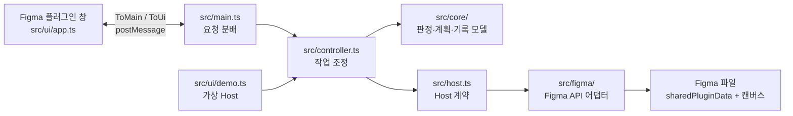

# GUI·UI Publish 아키텍처

이 문서는 현재 `src/` 구현의 경계와 데이터 흐름을 설명한다. 사용 방법과 화면 정책은 [BEHAVIOR](BEHAVIOR.md), 코드 변경 기준은 [CONVENTION](CONVENTION.md), 성능 측정과 개선 근거는 [PERFORMANCE_REVIEW](PERFORMANCE_REVIEW.md)를 본다.

## 실행 구조

Figma 파일 안에서 실행하는 단일 플러그인이다. `manifest.json`의 두 메뉴 명령 `gui`와 `ui`가 같은 `dist/code.js`를 실행하되, `src/main.ts`가 선택한 명령을 `GUI` 또는 `UI` 모드로 `Controller`에 전달한다. 외부 서버나 네트워크 호출은 없다.

`src/ui/index.ts`는 Figma UI iframe의 시작점이다. 메시지 형식과 `Map` 직렬화는 `src/core/wire.ts`에 둔다. 브라우저 미리보기는 같은 `Controller`와 UI를 실행하고 `Host`만 가짜 Figma 데이터(`src/ui/demo.ts`)로 교체한다. 튜토리얼(`src/ui/tutorial.ts`)도 플러그인 창 안에서 같은 가짜 환경에 두 번째 `Controller`·UI를 띄워 예시 화면을 만들고 실제 창 위에 겹친다. 예시 데이터는 본체 메시지(설정·스캔·배포·플립북 만들기)로 쌓으므로 저장 형식이 바뀌어도 따라가며, 실제 `Host`와 파일 기록에는 닿지 않는다. `build.mjs`는 Figma용 `dist/code.js`, 인라인 스크립트·스타일을 담은 `dist/ui.html`, 브라우저용 `dist/preview.html`을 만든다. `dist/`는 생성물이다.

## 코드 경계

| 위치 | 책임 |
|---|---|
| `src/core/types.ts`, `store.ts` | 파일 기록의 타입, 키 구성, 역직렬화, 메모리 상태와 저장소 동기화 |
| `src/core/compare.ts`, `fingerprint.ts`, `versionMatch.ts` | GUI 변경 판정, 지문 정규화, 새 버전 페이지의 화면 연결 제안 |
| `src/core/drafts.ts`, `publish.ts`, `registry.ts` | 입력 검증, GUI 배포 계획·확정, 카테고리·작업자·태그·화면 레지스트리 |
| `src/core/flow.ts` | 플로우 계획(배포된 화면·칸 겹침 검사, 잘못된 화살표 제외), 격자 칸 위치와 칸 사이 통로를 따르는 꺾인 화살표 경로(`routeLink`, 플러그인 판과 캔버스가 함께 씀), 조건 레이어 자리, 다시 배포된 화면이 든 플로우 고르기 |
| `src/core/richText.ts` | 텍스트 편집 탭의 문서 모델(문단·목록 단계·굵은 범위), 편집 동작(줄 나누기·합치기·붙여 넣기·굵게·목록 단계), 붙여 넣기·복사용 텍스트 형식 |
| `src/core/flipbooks.ts`, `flipbook.ts`, `guiScreens.ts`, `history.ts`, `data.ts` | 플립북 기록·확인 상태, 캔버스 반영용 뷰, 화면 목록·이력·DATA 모델 |
| `src/controller.ts` | 메시지 처리, 스캔·배포·플립북·관리 작업의 순서와 실패 보고 |
| `src/host.ts` | Controller가 요구하는 Figma 기능의 인터페이스. 코어에 Figma 노드 타입을 들이지 않는 경계 |
| `src/figma/host.ts` | `Host` 구현, 페이지·노드 탐색, 파일 저장소와 캔버스 API 연결 |
| `src/figma/snapshot.ts`, `fingerprints.ts` | 노드의 시각 속성·해석된 변수 값을 스냅샷으로 수집하고 지문·유사도 특징 생성 |
| `src/core/description.ts` | 텍스트 편집 적용 결과 타입 |
| `src/figma/description.ts` | 플립북 안 선택(여러 개·플립북 프레임 포함)에서 그 플립북의 Description을 찾고 텍스트 편집 대상을 알려 줌. 플립북 밖에서는 본문 슬롯이 있는 Description만 대상. 본문 슬롯에 굵은 제목 줄마다 제목·본문 레이어 묶음을 적용(슬롯에 있던 텍스트 서식을 이어받음)·불러오기. 제목 문구는 판정하지 않음 |
| `src/figma/richText.ts` | 고른 텍스트 레이어 하나의 본문·굵기·목록 단계 읽기와 쓰기(레이어 글꼴 유지) |
| `src/figma/flipbook.ts`, `layers.ts`, `thumbs.ts`, `data.ts` | 템플릿 복제, GUI 레이어 복사·배치, JPG 썸네일, DATA 페이지 렌더링 |
| `src/figma/flow.ts` | 플로우 프레임 그리기(격자 칸에 썸네일 이미지 채움, 빨간 더미 글자 레이어, 꺾인 화살표)와 다시 배포된 화면의 썸네일 채움 교체. 썸네일 이미지는 썸네일 페이지를 불러와 해시로 찾음 |
| `src/ui/app.ts`, `styles.css` | UI 상태·입력 초안·목록과 상세 렌더링 |
| `src/ui/flowView.ts` | UI Flipbook 플로우 탭의 배포 화면 목록(원본 페이지·루트 Section별 구분)과 FigJam식 판(격자 카드 배치·연결·삭제, 플로우 제목). Section은 `Host.screenSections()`가 플로우 탭을 열 때 캔버스에서 읽으며 저장 기록에는 넣지 않음 |
| `src/ui/textEditor.ts` | UI Flipbook 텍스트 편집 탭의 서식 편집기(contenteditable). 글자 입력은 브라우저, 구조 변경·되돌리기는 core 편집 동작으로 처리 |
| `src/ui/demo.ts`, `tutorial.ts`, `preview.ts` | 가짜 Figma 환경(`Host`), 튜토리얼의 예시 화면 조작과 말풍선, 브라우저 미리보기 도구 |

의존성의 중심은 `core`다. `Controller`는 코어 함수를 호출하고 환경 작업을 `Host`에 맡긴다. Figma API를 쓰는 새 기능은 `figma` 어댑터에, 저장 기록의 규칙은 `core`에 두는 것이 기존 경계와 맞는다.

## 저장 모델과 식별자

영속 기록의 기준은 `figma.root`의 `sharedPluginData('guiuipublish', key)`다. `Store`는 키별 JSON을 `State`의 `Map`으로 읽는다. `project`에는 GUI 범위 페이지·Section, UI 페이지·템플릿, DATA 페이지, 화면 크기 등의 설정이 들어간다. 주요 키는 다음과 같다.

| 키 접두사 | 기록 |
|---|---|
| `scr:{id}`, `gv:{id}:{version}` | 화면의 현재 상태와 GUI 버전 이력 |
| `fb:{id}`, `fgv:{flipbookId}:{screenId}:{version}` | 플립북 상태와 플립북에 가져온 GUI 이력 |
| `sui:{id}`, `uv:{id}:{version}`, `rv:{id}` | UI 상태·이력과 플립북 확인 완료 시점의 화면별 GUI 버전 |
| `bat:{id}`, `dlv:{batchId}:{targetId}` | 확정 묶음과 후속 플립북 반영 상태 |
| `cat:`, `wrk:`, `tag:`, `exc:`, `aud:`, `data` | 관리 항목, 제외, 감사 기록, DATA 렌더 상태 |
| `flw:{id}` | 플로우 프레임의 위치(페이지·노드)와 들어 있는 화면. 다시 배포된 화면의 썸네일을 바꾸려고 찾는 데만 쓰며 이력은 없다. 썸네일마다의 화면·버전은 프레임 안 사각형의 `flowScreen`·`flowVersion` 표식에 둔다 |

내부 화면 ID(`Screen.id`)는 플립북의 `uid`로도 쓰는 고정 식별자다. 사람이 보는 Screen ID(`Screen.code`)와 화면 이름은 별도 기록이며 GUI 원본 프레임 이름을 바꾸지 않는다. 원본 프레임의 `screenId`, 플립북 프레임의 `flipbookOf`·`flipbookNode`, GUI 복사본의 표식 등 노드 `sharedPluginData`는 기록과 캔버스를 연결한다. UI 창 크기만 사용자별 `figma.clientStorage`에 저장한다.

키를 화면·플립북·버전별로 나눠 관련 없는 화면의 쓰기가 같은 키를 덮어쓰지 않게 했다. `Store.reload()`는 원시 값이 바뀌었을 때 상태를 다시 만들고, 확정 직전의 충돌 검사는 `readFresh()`로 해당 키를 직접 읽는다. GUI 확정은 `Screen.rev`, 남아 있는 UI Publish 경로는 `UiState.rev`로 동시 변경을 검사한다. 이 설계는 파일 전체의 원자적 트랜잭션을 제공하지 않으므로, 아래의 배포 기록과 캔버스 반영을 별도 단계로 다룬다.

`GUI 썸네일 (자동 관리)` 페이지는 썸네일 이미지 보관·조회에, DATA 페이지는 파일 내부 기록의 읽기용 투영에 사용한다. 둘 다 업무 기록의 원본 저장소는 아니다. `data` 키에는 마지막 DATA 렌더 성공·실패 상태를 남긴다.

## GUI 변경 확인과 Publish

1. `Controller.scan()`이 설정된 GUI 페이지의 최상위 또는 Section 안 화면 루트를 `Host.listFrames()`로 모은다. 저장된 원본 연결과 비교해 신규·변경·원본 없음·비교 전 등의 목록을 만든다.
2. `Snapshotter`가 화면에 영향을 주는 노드 속성과 변수의 해석 값을 수집한다. `core/fingerprint.ts`가 이름과 루트 캔버스 위치를 제외하고 정규화해 해시를 만든다. 구형 지문이 기준인 화면은 구형 해시도 계산해, 결과가 같을 때 새 정규화 기준으로 옮긴다.
3. UI 입력 초안을 `buildPlan()`이 검증해 최종 확인용 계획을 만든다. 확정 시 `Controller.commit()`은 대상 원본 지문을 다시 계산하고 필요한 JPG 썸네일을 만든다. `commitPlan()`은 저장된 `rev`, 지문, Screen ID 충돌 등을 재검사한다.
4. 통과한 화면마다 GUI 버전·화면 상태를 저장하고 묶음 기록을 남긴다. 일부 화면이 충돌하면 나머지만 확정하고 충돌 항목은 다시 입력할 수 있게 돌려준다. 원본 프레임에는 연결 표식만 남긴다.
5. 확정 뒤 썸네일을 캔버스에 놓고, 그 화면을 쓰는 플립북에 새 GUI 이력을 가져와 반영하고, 그 화면이 든 플로우의 썸네일 채움을 바꾼 다음(`updateFlows()`, 프레임이 없으면 `flw:` 기록 삭제) DATA 페이지를 갱신한다. 썸네일·플립북·플로우·DATA 실패는 확정 기록과 구분해 보고한다.

새 버전 페이지에서는 `versionMatch.ts`가 새 프레임의 지문·텍스트·이미지·레이어 특징과 기존 원본을 비교해 연결을 제안한다. 사용자가 확인한 연결로 `Screen.source`와 GUI 범위를 옮긴다. 이 작업 자체는 GUI 버전을 만들지 않는다.

## 플립북 생성·갱신·확인

UI Flipbook의 현재 화면 흐름은 **플립북 만들기, GUI 갱신 알림, 확인 완료**다. `Controller`와 코어에는 과거 UI Publish용 스캔·계획·확정 경로가 남아 있지만 현재 UI의 툴바에는 UI 배포 기능이 노출되지 않는다. `uv:` 이력은 현재 확인 완료의 상태·코멘트 기록에도 사용하며 이전 기록을 읽는 호환 경로도 있다.

1. 만들기 요청의 화면·페이지·Section·배율을 `planFlipbooks()`가 플립북 모델로 만든다. `deliverFlipbooks()`가 템플릿을 검사하고 프레임을 복제해 제목, Status, Screen ID, GUI 영역과 이력을 채운다. 화면이 없는 플립북도 만들 수 있다. 같은 요청의 `moves`(목록에서 옮긴 기존 플립북)는 만들기 전에 `checkMoves()`로 확인하고, 목록 순서대로 `Host.moveFlipbook()`(Figma: `moveFlipbookFrame()`)으로 프레임을 옮긴 뒤 `moveFlipbooks()`가 페이지·Section 기록을 바꾼다. Section이 바뀐 플립북은 다시 반영해 Chapter를 맞춘다.
2. GUI Publish 후 `importGuiUpdates()`가 플립북에 들어 있는 화면의 새 버전과 이력 사본을 기록한다. `syncFlipbook()`은 원본 GUI 레이어를 복사해 설정 폭과 1x·1/2x·1/4x 배율로 배치한다. 버전·배율·폭이 같은 기존 복사본은 재사용한다.
3. 템플릿과 플립북의 플러그인 관리 영역만 수정한다. Description 내용, 콜아웃, 마커는 보존하고 GUI 복사본을 다시 배치할 때 해당 화면을 따라 마커 위치를 옮긴다.
4. 새 GUI 이력이 `rv:`에 저장된 화면별 확인 버전보다 앞서면 플립북에 확인 필요 표시를 한다. `markReviewed()`는 그때까지의 버전, Status 태그와 코멘트를 저장하고 플립북의 표시·이력 행을 갱신한다. 시각 대신 화면별 버전으로 확인 여부를 판단한다.
5. 플립북의 페이지·Section은 캔버스가 원본이다. Figma `inspectFlipbooks()`가 루트 Section(페이지 바로 아래 Section)마다 플립북 프레임의 자리(`FlipbookSpot`: 페이지, Section 키·이름, 순서)를 읽는다. 안쪽 Section은 없는 것으로 보고 루트 Section 좌표로 세며, 표식 없는 루트 Section에는 키를 붙이고 복제로 겹친 키는 새로 붙인다. Section 밖 프레임은 `NO_SECTION_KEY`(「(섹션 없음)」) 자리다. 코어 `canvasSections()`·`followCanvasSections()`가 기록과 다른 플립북의 페이지·Section을 캔버스에 맞춘다. 캔버스 선택이 바뀌어 기록과 다른 플립북을 찾으면 `syncCanvasSections()`가 쓰기 큐에서 기록을 맞추고 `Host.syncChapters()`로 Chapter만 다시 쓴다. `deliverFlipbooks()`도 반영 전에 같은 맞춤을 한 번 한다(부른 쪽이 이미 맞췄으면 `canvasFollowed`, 이미 읽은 캔버스는 `canvas`로 넘겨 다시 읽지 않는다). 플러그인은 프레임을 기록의 Section으로 되돌리지 않는다.

플립북 반영은 `dlv:`의 `pending → applying → done/failed` 상태로 추적한다. 한 플립북 반영이 실패해도 다른 플립북은 계속 처리하며, 재시도로 미완료 대상을 다시 맞출 수 있다. GUI 복사본의 원천은 GUI 원본 프레임이며, 별도 이미지 라이브러리나 외부 전달 서버를 거치지 않는다.

## 응답성 및 변경 시 유의점

- `main.ts`는 파일을 바꾸는 메시지를 하나의 큐에서 순서대로 실행한다. 스캔·취소·탐색은 큐 밖에서 처리하며, 작업 시퀀스 번호로 오래된 결과를 버린다. 캔버스 선택 이벤트는 80ms 동안 마지막 변경만 처리하고, 그 처리에서 기록과 다른 Section을 찾으면 `syncCanvasSections()`를 쓰기 큐에 넣는다. 캔버스를 읽는 `inspectFlipbooks()`는 Section 표식(키)을 붙이는 쓰기를 할 수 있다(배치는 바꾸지 않는다).
- 긴 스캔은 일정 간격으로 이벤트 루프에 양보하고 진행률을 묶어 보낸다. 한 번의 스캔 안에서는 `Snapshotter`의 변수 조회 캐시를 공유한다. 플립북 전달 작업 안에서는 페이지·프레임·템플릿 조회 캐시를 공유하되 다음 전달에서는 다시 읽는다.
- 화면 지문 규칙을 바꾸면 `FINGERPRINT_VERSION`과 구형 기준 비교 경로를 함께 검토한다. 템플릿의 플러그인 관리 영역을 바꾸면 `figma/flipbook.ts`의 탐색·동기화와 UI 작성 영역 제외 규칙을 함께 확인한다.
- `sharedPluginData` 키나 모델을 바꿀 때 `store.ts`의 로딩·호환 경로, `wire.ts`의 UI 직렬화, DATA 모델, 미리보기 Host를 함께 확인한다. 기존 데이터는 전체 자동 마이그레이션하지 않는다.

## 로컬 확인

`npm run check`는 타입 검사, 현재 `test/*.test.ts` 테스트, Figma·미리보기 빌드를 실행한다. `npm run walkthrough`는 브라우저 미리보기에서 주요 흐름을 조작하고, `npm run benchmark`는 Node 측 성능을 측정한다. 미리보기는 Figma API를 대체하므로 레이어 복사, 변수 모드, JPG 내보내기, 실제 큰 파일의 시간·메모리는 Figma 시험 파일에서 확인해야 한다.
